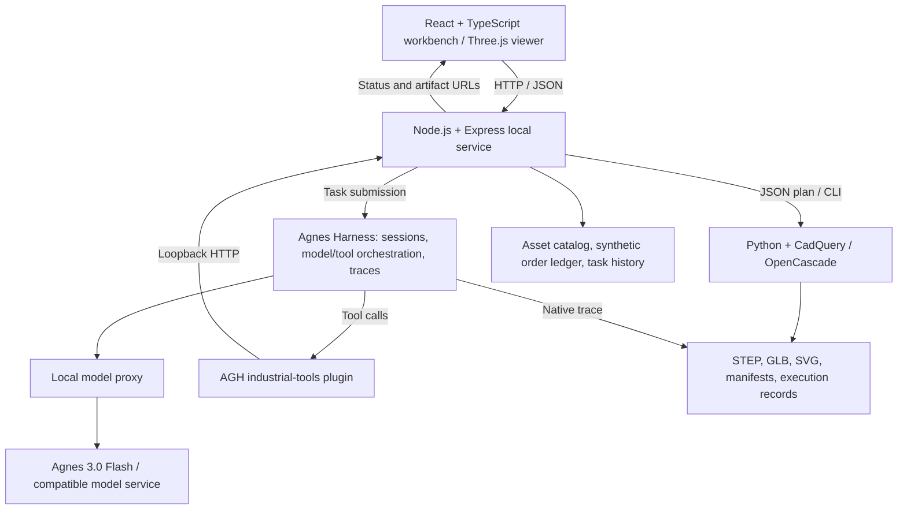

# EngineerAgent

English | [简体中文](README.zh-CN.md)

<div align="center">

### From engineering drawings to checkable results.

**An engineering agent for machining teams, powered by Agnes Harness.**

[](https://github.com/AgnesAI-Labs/agnes-harness)
[](LICENSE)
[](https://nodejs.org/)
[](https://www.python.org/downloads/)

[Try online](https://engineeragent.liudonghe.com/) · [Project Overview](#project-overview) · [Demo Video](#demo-video) · [Architecture](#architecture) · [Integration Standards](#integration-standards) · [Quick Start](#quick-start)

</div>

EngineerAgent brings drawing reconstruction, order review, and parts retrieval into one workbench. The official **Agnes Harness (AGH)** orchestrates the model and industrial tools; **Agnes 3.0 Flash** is the default model for local installations. Tool calls and measured results remain visible throughout each task, and native AGH execution records can be exported for review.

<details>
<summary><kbd>Contents</kbd></summary>

- [Project Overview](#project-overview)
- [Demo Video](#demo-video)
- [Architecture](#architecture)
- [Integration Standards](#integration-standards)
- [Quick Start](#quick-start)
- [Models](#models)
- [Examples and Execution Records](#examples-and-execution-records)
- [FAQ](#faq)
- [Development and Verification](#development-and-verification)
- [License](#license)

</details>

## Project Overview

### Background

Small and medium machining businesses handle drawings, purchase orders, parts libraries, and production estimates across separate tools. EngineerAgent connects these steps through an agent workbench: the model interprets the request, AGH coordinates execution, and dedicated tools produce geometry, checks, and order calculations that users can inspect.

### Core capabilities

| Capability | Workflow | Outputs |
| --- | --- | --- |
| **Drawing reconstruction** | Read a part or assembly drawing, build a parametric CAD model, measure the actual solid, and project it back into drawing views. Request missing dimensions before building. | STEP/GLB models, front/top/side SVG views, inspection results; assemblies also include an exploded view and bill of materials (BOM). |
| **Order review** | Parse purchase lines, match part identity/material/revision/specification, allocate available stock within the review, and estimate remaining production hours and capacity gaps. Flag conflicts and search for candidate parts. | Per-line findings, blockers, estimated hours, and capacity evidence, based on the bundled synthetic enterprise ledger. |
| **Parts retrieval** | Search 45 engineering assets by name, identifier, use case, structure, and related terms, with source and license information. | Candidate parts with model links, 3D previews, and assembly details where available. |

### What makes it useful

- **A geometry verification loop:** the model proposes a plan; CadQuery/OpenCascade builds and measures the solid. Checks cover specified dimensions, hole positions, assembly placement, interference, and sampled disassembly paths. Failures feed back into repairs.
- **Explicit handling of unknowns:** missing or conflicting engineering evidence produces a structured clarification request instead of guessed dimensions or unsupported estimates.
- **Reusable industrial tools:** drawing access, catalog search, order rules, and CAD operations are packaged as an AGH plugin rather than embedded in model responses.
- **Traceable results:** live tool inputs/results, CAD artifacts, and native AGH traces make the result reviewable after the task ends.

The order ledger is demonstration data. Order review calculates allocations without reserving real stock or scheduling production; geometry checks report their defined scope, and disassembly checks use discrete samples. See the [CAD tool contract](tools/cad/README.md) and [demo evidence](docs/demo-cases.md) for details.

## Demo Video

**[Watch the demo — 1080p](https://engineeragent.liudonghe.com/media/engineeragent-demo-1080p.mp4)** · [720p](https://engineeragent.liudonghe.com/media/engineeragent-demo-720p.mp4) · [Open the online workbench](https://engineeragent.liudonghe.com/)

<p align="center">
  <a href="https://engineeragent.liudonghe.com/media/engineeragent-demo-1080p.mp4">
    
  </a>
</p>

The video is approximately **4 minutes 30 seconds** and records actual local-workbench operation. Model waiting periods are accelerated and labeled; narration uses synthesized speech. Video files are hosted separately from this repository.

To try the workflow yourself:

1. Open the [online demo](https://engineeragent.liudonghe.com/) or follow [Quick Start](#quick-start).
2. Choose a built-in case under Drawing Reconstruction (图纸重建), Order Review (订单评审), or Parts Retrieval (零件检索).
3. Inspect the tool calls, checks, and resulting artifacts, then export the execution record from History (历史记录).

The online demo uses **MiniMax-M3** with a deployment-managed connection; local installations default to **Agnes 3.0 Flash** and accept your own API key. The fallback demo address is [http://175.27.128.112/](http://175.27.128.112/). Recorded Agnes runs and expected outcomes are documented in [demo cases](docs/demo-cases.md).

## Architecture



| Module | Implementation | Responsibility |
| --- | --- | --- |
| **Workbench and viewer** | [`src/`](src/) — React, TypeScript, Three.js | Task entry, drawing upload, 3D/exploded views, inspection reports, and history. |
| **Application service** | [`server/`](server/) — Node.js, Express | HTTP endpoints, document ingestion, task scheduling, catalog/order operations, and artifact/record export. |
| **AGH integration** | [`integrations/agh/`](integrations/agh/) | Runtime setup, model connection, task/session execution, and native trace export. |
| **Industrial plugin** | [`integrations/agh/industrial-tools/`](integrations/agh/industrial-tools/) | Structured tool definitions for input evidence, catalog search, order review, clarification, and geometry. |
| **CAD execution** | [`tools/cad/`](tools/cad/) — Python, CadQuery, OpenCascade | Parametric feature plans, solid measurements, assembly checks, projections, and STEP/GLB export. |
| **Assets and evidence** | [`assets/`](assets/), local `data/` | Versioned reference assets and evaluation records; local uploads, task results, settings, and history. |

The AGH runtime is pinned to upstream commit [`cde816b8`](https://github.com/AgnesAI-Labs/agnes-harness/commit/cde816b88c737b9fd04e7ef55b899e7b4cd55eb7) in [`runtime-lock.json`](integrations/agh/runtime-lock.json). Model credentials are forwarded by the local proxy rather than passed into the AGH process. Geometry conclusions come from tool measurements, with verification results recorded alongside generated artifacts.

## Integration Standards

### AGH plugin contract

The industrial plugin is an ES module package, **`@panpan/industrial-tools`** (version `0.3.0`), declared through `agnes.plugins` in its [`package.json`](integrations/agh/industrial-tools/package.json). It obtains the AGH `extension` service and registers tools with `registerTool`. Parameters use JSON schemas; results include text content plus a structured payload and `isError`.

| Tool | Input contract | Purpose |
| --- | --- | --- |
| `industrial_read_input` / `industrial_get_document` | `path` / `documentId` | Read uploaded evidence, document metadata, and extracted text/images. |
| `industrial_search_catalog` | Optional `query`, `category`, `format`, `limit` | Retrieve candidates with identifiers, model URLs, provenance, and licenses. |
| `industrial_review_order` | Original purchase `text` | Apply deterministic matching, stock-allocation, and production-hour rules. |
| `industrial_request_clarification` | `question`, `missing[]` with `item` and optional `evidence` | Return `status: "needs_input"` when evidence is incomplete. |
| `industrial_geometry` | `operation`, `input` object | Run `build`, `validate`, `project`, `patch`, `assembly`, `import`, or `compare_views`. |

The plugin connects to the application through `AGH_INDUSTRIAL_ROOT` (absolute project path) and `AGH_INDUSTRIAL_API` (an `http://127.0.0.1:PORT` origin). The setup process installs and trusts the local package using its integrity and capability hashes. See the [plugin implementation](integrations/agh/industrial-tools/index.mjs) and [runtime setup](integrations/agh/common.mjs).

### HTTP interfaces

The workbench uses same-origin HTTP endpoints, normally at `http://127.0.0.1:4310`. JSON requests use `Content-Type: application/json`; uploads use `multipart/form-data`. The following are the current application interfaces in [`server/index.mjs`](server/index.mjs):

| Method and path | Request / response |
| --- | --- |
| `GET /api/health` | Model configuration, AGH/CAD availability, and application version. |
| `POST /api/documents` | Upload a `file` field; receive a document record containing its `id`. |
| `GET /api/documents/:id` | Read document metadata and extracted page content. |
| `GET /api/catalog` | Read the asset catalog; the plugin applies its search filters to this data. |
| `POST /api/orders/review` | `{ "text": "..." }` → structured order report. |
| `POST /api/geometry` | `{ "operation": "build", "input": { ... } }` → `success`, `verified`, `runId`, `manifest`, `artifacts`. |
| `POST /api/tasks` | `mode`, `instruction`, and drawing `documentId`/`pages` when required → HTTP `202` with a task `id`. Agent modes: `reconstruct`, `order_review`, `catalog_search`. |
| `GET /api/tasks/:id` | Poll task status, events, and results. |
| `POST /api/tasks/:id/cancel` | Request cancellation of a queued or running task. |
| `GET /api/tasks/:id/trace` | Download the native AGH JSONL trace, once available. |
| `GET /api/history/:id/export` / `GET /api/history/export` | Download one task or all execution records as ZIP. |

For example, after configuring a model in the local workbench, submit this JSON body to `POST /api/tasks`:

```json
{
  "mode": "catalog_search",
  "instruction": "Find a mounting bracket with holes for positioning and clamping."
}
```

Then poll `GET /api/tasks/<id>` using the returned task ID. For reconstruction, upload the drawing first and include `documentId` and selected `pages`. Configure an image-capable model for drawing input. These are the current workbench contracts; the repository does not declare a versioned external API.

### CAD and artifact formats

- **Input:** JSON feature/assembly plans with stable feature IDs. The CAD runner accepts defined operations rather than executing user-supplied Python.
- **Coordinates:** millimeters (`mm`), **Z-up**, including GLB outputs. Integrations must follow the manifest instead of assuming GLB uses meters/Y-up.
- **Outputs:** STEP for CAD exchange, GLB/mesh JSON for visualization, SVG for projected views, and `manifest.json` for measurements, checks, errors, and artifact references.
- **Verification:** `status: "completed"` means computation completed. Read `manifest.verification.passed` and the API's `verified` field separately; `null` means verification is unavailable. Disassembly-path results cover the sampled positions.
- **Records and provenance:** native `trace.agnes.jsonl`, workbench `task.json`, and ZIP exports support review. Export removes credentials and local absolute paths. Public assets retain the source and license terms in [asset sources](docs/asset-sources.md).

The [CAD tool reference](tools/cad/README.md) defines plan fields, supported operations, CLI usage, and verification limits.

### Connecting models and business data

Model connections support official Agnes, OpenAI-compatible, Anthropic-compatible, and OpenRouter providers. Configure the provider, API base URL, model ID, and key in the workbench; external endpoints use HTTPS, with HTTP allowed for loopback services. See [provider settings](server/provider-settings.mjs).

The current catalog and order review read bundled assets and a synthetic ledger. To adapt the project to a business system, replace or extend the application data/service layer and expose the capability through the AGH plugin contract. The current project does not include a live ERP/MES connector or machine-control integration.

## Quick Start

Install [Node.js](https://nodejs.org/) **24.10+**, [Python](https://www.python.org/downloads/) **3.12**, and [Git](https://git-scm.com/downloads). AGH also needs the platform's native C/C++ build tools.

| Platform | Additional setup | Launch |
| --- | --- | --- |
| macOS | Xcode command-line tools: `xcode-select --install` | Double-click `启动工程助手.command`. If blocked on first launch, right-click → Open. |
| Windows | Visual Studio Build Tools with **Desktop development with C++** and Windows SDK; add Python to PATH. | Double-click `启动工程助手.bat`. |
| Linux | `build-essential`, `python3.12-venv` (Debian/Ubuntu package names). | Run the command below. |

Get the source and start the workbench:

```sh
git clone https://github.com/zicheng-yu/Agnes-Hackathon-EngineerAgent.git
cd Agnes-Hackathon-EngineerAgent
node scripts/start-local.mjs --install --open
```

The browser opens at [http://127.0.0.1:4310](http://127.0.0.1:4310). Click the model button below the input box, enter and save your API key, then select a built-in case.

First launch installs dependencies and builds AGH, which can take several minutes. Downloads default to Chinese mirrors (Tsinghua for Python; npmmirror for npm/pnpm). Set `ENGINEERAGENT_MIRROR=off` to use official sources. Keep the terminal open; press Ctrl+C to stop.

## Models

The local default is **official Agnes / `agnes-3.0-flash`**. Choose a provider, base URL, model, and key through the model button to use another supported service. Provider keys are stored locally under `data/` and excluded from the repository and submission archive. For MiniMax-M3 on compatible connections, the app automatically sends `thinking: {type: "disabled"}` to keep reasoning from consuming the single-request output budget.

## Examples and Execution Records

Each task page includes built-in cases: **one assembly drawing** (four part types, 15 instances), **one drawing with a missing dimension**, **two purchase orders**, and **three catalog searches**, covering normal, boundary, and exception cases.

Expected outcomes and recorded Agnes 3.0 Flash runs are in [demo cases](docs/demo-cases.md). Native records are stored in [`assets/evaluation/agh-runs/`](assets/evaluation/agh-runs/), indexed by [`report.json`](assets/evaluation/report.json). The earlier single-part drawing runs remain archived there.

In the workbench, use **History → Export all execution records** (历史记录 → 导出全部执行记录), or export a single task from its result. Exports contain task records, native AGH traces, input drawings, available CAD artifacts, and a readable summary.

## FAQ

- **Port already in use:** the launcher searches for a free port starting at 4310 and prints the actual address.
- **Dependency download fails:** retry after checking the reported error; set `ENGINEERAGENT_MIRROR=off` if the mirror is unavailable.
- **AGH build fails on Windows:** install Visual Studio Build Tools with Desktop development with C++ and Windows SDK.
- **Python is not 3.12:** set `ENGINEERAGENT_PYTHON=/path/to/python3.12`; move an incompatible existing `.venv` aside before retrying.
- **The first CadQuery check is slow on macOS:** initial native-library signature verification can take several minutes; progress remains visible in the terminal.
- **The AGH checkout has local modifications:** setup stops to avoid overwriting them. Move `integrations/agh/vendor-runtime` aside before retrying.

## Development and Verification

```sh
node scripts/verify-local.mjs
```

Runs build, UI, packaging, CAD, service, and AGH checks without a model API key. See [demo cases](docs/demo-cases.md) for model-backed reproduction and expected results.

## License

Project code is released under the [MIT License](LICENSE). AGH uses Apache-2.0; its license and NOTICE are in [`third-party/agnes-harness/`](third-party/agnes-harness/). Public engineering assets retain their upstream licenses; see [sources and conditions](docs/asset-sources.md).
