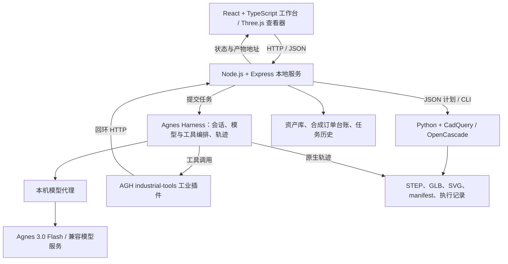

# EngineerAgent

[English](README.md) | 简体中文

<div align="center">

### 从工程图纸到可复核的结果。

**面向机加工团队的工程智能体，以 Agnes Harness 为运行底座。**

[](https://github.com/AgnesAI-Labs/agnes-harness)
[](LICENSE)
[](https://nodejs.org/)
[](https://www.python.org/downloads/)

[在线体验](https://engineeragent.liudonghe.com/) · [项目介绍](#project-overview) · [视频介绍](#demo-video) · [架构介绍](#architecture) · [集成标准](#integration-standards) · [快速启动](#quick-start)

</div>

EngineerAgent 将图纸重建、订单评审与零件检索整合在一个工作台中。官方 **Agnes Harness（AGH）** 负责编排模型与工业工具，本地安装默认使用 **Agnes 3.0 Flash**。任务中的工具调用与实测结果实时可见，并可导出 AGH 原生执行记录供复核。

<details>
<summary><kbd>目录</kbd></summary>

- [项目介绍（Project Overview）](#project-overview)
- [视频介绍（Demo Video）](#demo-video)
- [架构介绍（Architecture）](#architecture)
- [集成标准（Integration Standards）](#integration-standards)
- [快速启动](#quick-start)
- [模型](#models)
- [测试案例与执行记录](#examples-and-execution-records)
- [常见问题](#faq)
- [开发与验证](#development-and-verification)
- [许可](#license)

</details>

<a id="project-overview"></a>

## 项目介绍（Project Overview）

### 项目背景

中小机加工企业通常需要在多个工具之间处理工程图纸、采购订单、零件库与生产工时估算。EngineerAgent 通过智能体工作台串联这些步骤：模型理解任务，AGH 组织执行，专用工具完成几何运算、实体检查与订单计算，并将依据呈现给用户。

### 核心功能

| 功能 | 执行流程 | 输出 |
| --- | --- | --- |
| **图纸重建** | 读取零件图或装配图，构建参数化 CAD 模型，实测实体并生成回投影视图；缺少尺寸时先请求补充。 | STEP/GLB 模型、正视/俯视/侧视 SVG、检查结果；装配体另含爆炸视图与物料清单（BOM）。 |
| **订单评审** | 解析采购明细，匹配零件身份、材质、版本与规格，在本次评审中分配可用库存，估算待产工时与产能缺口；标出冲突并检索候选件。 | 基于内置合成企业台账的逐行结论、阻塞项、估算工时与产能依据。 |
| **零件检索** | 在 45 条工程资产中按名称、编号、用途、结构及相关词检索，保留来源与许可信息。 | 带模型链接的候选零件、三维预览，以及可用的装配信息。 |

### 创新亮点

- **几何验证闭环**：模型提出计划，CadQuery/OpenCascade 构建并实测实体；按明确检查项验证尺寸、孔位、装配位置、干涉与离散采样的拆卸路径，检查失败后反馈修复。
- **显式处理未知信息**：缺少或存在冲突的工程依据会触发结构化补充请求，避免猜测尺寸或给出缺乏依据的估算。
- **可复用的工业工具**：图纸读取、零件检索、订单规则与 CAD 操作封装为 AGH 插件能力。
- **可追溯的执行结果**：工具输入与输出、CAD 产物及 AGH 原生轨迹可供任务结束后复核。

订单台账为演示数据。订单评审中的库存分配属于计算，不会预占真实库存或下发生产排程；几何结果按所列检查项解释，拆卸检查采用离散采样。详细范围见 [CAD 工具说明](tools/cad/README.md) 与 [案例证据](docs/demo-cases.md)。

<a id="demo-video"></a>

## 视频介绍（Demo Video）

**[观看演示视频 — 1080p](https://engineeragent.liudonghe.com/media/engineeragent-demo-1080p.mp4)** · [720p](https://engineeragent.liudonghe.com/media/engineeragent-demo-720p.mp4) · [打开在线工作台](https://engineeragent.liudonghe.com/)

<p align="center">
  <a href="https://engineeragent.liudonghe.com/media/engineeragent-demo-1080p.mp4">
    
  </a>
</p>

视频约 **4 分 30 秒**，画面为本地工作台的真实操作。等待模型的片段已加速并标注倍速，配音使用语音合成。视频文件单独托管，不包含在本仓库中。

自行体验流程：

1. 打开 [在线体验](https://engineeragent.liudonghe.com/)，或按 [快速启动](#quick-start) 在本机运行。
2. 在“图纸重建”“订单评审”或“零件检索”页面选择内置测试案例。
3. 查看工具调用、检查结果与输出产物，再从“历史记录”导出执行记录。

在线体验版由部署方固定接入 **MiniMax-M3**；本地安装默认使用 **Agnes 3.0 Flash**，支持填写自己的 API Key。备用体验地址为 [http://175.27.128.112/](http://175.27.128.112/)。Agnes 运行记录与预期结果见 [测试案例说明](docs/demo-cases.md)。

<a id="architecture"></a>

## 架构介绍（Architecture）



| 模块 | 技术与位置 | 职责 |
| --- | --- | --- |
| **工作台与查看器** | [`src/`](src/) — React、TypeScript、Three.js | 任务输入、图纸上传、三维与爆炸视图、检查报告、历史记录。 |
| **应用服务** | [`server/`](server/) — Node.js、Express | HTTP 接口、文档导入、任务调度、零件库与订单操作、产物和记录导出。 |
| **AGH 集成层** | [`integrations/agh/`](integrations/agh/) | 运行时安装、模型连接、任务与会话执行、原生轨迹导出。 |
| **工业插件** | [`integrations/agh/industrial-tools/`](integrations/agh/industrial-tools/) | 定义输入证据、零件检索、订单评审、补充资料与几何操作的结构化工具。 |
| **CAD 执行层** | [`tools/cad/`](tools/cad/) — Python、CadQuery、OpenCascade | 参数化特征计划、实体实测、装配检查、投影与 STEP/GLB 导出。 |
| **资产与证据** | [`assets/`](assets/)、本机 `data/` | 版本化参考资产与评估记录；本机上传文件、任务结果、设置及历史。 |

AGH 运行时通过 [`runtime-lock.json`](integrations/agh/runtime-lock.json) 锁定上游提交 [`cde816b8`](https://github.com/AgnesAI-Labs/agnes-harness/commit/cde816b88c737b9fd04e7ef55b899e7b4cd55eb7)。模型密钥由本机代理转发，不传入 AGH 进程。几何结论来自工具对实体的实测，验证结果随产物一同保存。

<a id="integration-standards"></a>

## 集成标准（Integration Standards）

### AGH 插件规范

工业插件是 ES Module 包 **`@panpan/industrial-tools`**（版本 `0.3.0`），通过 [`package.json`](integrations/agh/industrial-tools/package.json) 中的 `agnes.plugins` 声明，获取 AGH `extension` 服务后使用 `registerTool` 注册工具。参数采用 JSON Schema 描述，返回值包含文本内容、结构化数据及 `isError`。

| 工具 | 输入规范 | 用途 |
| --- | --- | --- |
| `industrial_read_input` / `industrial_get_document` | `path` / `documentId` | 读取上传证据、文档元数据与提取的文本/图像。 |
| `industrial_search_catalog` | 可选的 `query`、`category`、`format`、`limit` | 返回含编号、模型链接、来源及许可的候选件。 |
| `industrial_review_order` | 采购原文 `text` | 执行确定性的零件匹配、库存分配与工时规则。 |
| `industrial_request_clarification` | `question`、`missing[]`；每项含 `item` 与可选的 `evidence` | 证据不完整时返回 `status: "needs_input"`。 |
| `industrial_geometry` | `operation`、`input` 对象 | 执行 `build`、`validate`、`project`、`patch`、`assembly`、`import` 或 `compare_views`。 |

插件通过 `AGH_INDUSTRIAL_ROOT`（项目绝对路径）与 `AGH_INDUSTRIAL_API`（`http://127.0.0.1:PORT` 形式的服务源地址）连接应用。安装流程根据完整性摘要与能力哈希安装并信任本地包。实现见 [工业插件](integrations/agh/industrial-tools/index.mjs) 与 [运行时配置](integrations/agh/common.mjs)。

### HTTP 接口规范

工作台使用同源 HTTP 接口，默认地址为 `http://127.0.0.1:4310`。JSON 请求使用 `Content-Type: application/json`，文件上传使用 `multipart/form-data`。以下接口以当前 [`server/index.mjs`](server/index.mjs) 实现为准：

| 方法与路径 | 请求 / 响应 |
| --- | --- |
| `GET /api/health` | 模型配置状态、AGH/CAD 可用性与应用版本。 |
| `POST /api/documents` | 通过 `file` 字段上传文件，返回包含 `id` 的文档记录。 |
| `GET /api/documents/:id` | 读取文档元数据及提取的页面内容。 |
| `GET /api/catalog` | 读取资产目录；插件在此数据上应用检索条件。 |
| `POST /api/orders/review` | `{ "text": "..." }` → 结构化订单报告。 |
| `POST /api/geometry` | `{ "operation": "build", "input": { ... } }` → `success`、`verified`、`runId`、`manifest`、`artifacts`。 |
| `POST /api/tasks` | 提交 `mode`、`instruction`，图纸任务另传 `documentId`/`pages` → HTTP `202`，返回含 `id` 的任务。智能体模式为 `reconstruct`、`order_review`、`catalog_search`。 |
| `GET /api/tasks/:id` | 轮询任务状态、事件与结果。 |
| `POST /api/tasks/:id/cancel` | 请求取消排队中或执行中的任务。 |
| `GET /api/tasks/:id/trace` | 原生 AGH JSONL 轨迹生成后可下载。 |
| `GET /api/history/:id/export` / `GET /api/history/export` | 以 ZIP 下载单次或全部执行记录。 |

例如，在本地工作台配置模型后，向 `POST /api/tasks` 提交以下 JSON 请求体：

```json
{
  "mode": "catalog_search",
  "instruction": "查找用于定位和夹持的带孔安装支架。"
}
```

随后使用返回的任务 ID 轮询 `GET /api/tasks/<id>`。图纸重建需先上传图纸，再传入 `documentId` 与选中页码 `pages`，并配置支持图像输入的模型。上述规范描述当前工作台接口；仓库尚未声明带版本承诺的外部 API。

### CAD 与产物格式

- **输入格式**：使用带稳定特征 ID 的 JSON 特征计划或装配计划；CAD 执行器仅接受定义好的操作，不执行输入提供的 Python。
- **坐标规范**：使用毫米（`mm`）与 **Z-up**，GLB 输出也保留该坐标；接入方应读取 manifest，不能默认按米/Y-up 处理。
- **输出格式**：STEP 用于 CAD 交换，GLB/mesh JSON 用于可视化，SVG 用于投影视图；`manifest.json` 保存实测值、检查项、错误与产物引用。
- **验证语义**：`status: "completed"` 表示运算完成；应单独读取 `manifest.verification.passed` 与 API 的 `verified` 字段，`null` 表示未获得验证结论。拆卸路径结果只覆盖采样位置。
- **记录与来源**：使用原生 `trace.agnes.jsonl`、工作台 `task.json` 与 ZIP 导出支持复核；导出时去除密钥与本机绝对路径。公开资产保留 [来源与许可条件](docs/asset-sources.md)。

计划字段、支持操作、CLI 用法及验证范围见 [CAD 工具参考](tools/cad/README.md)。

### 模型与业务数据接入

模型连接支持官方 Agnes、OpenAI 兼容、Anthropic 兼容及 OpenRouter 服务。通过工作台配置服务类型、API 基础地址、模型 ID 与 Key；外部接口使用 HTTPS，本机回环服务允许 HTTP。配置实现见 [模型连接设置](server/provider-settings.mjs)。

当前零件检索与订单评审读取内置资产和合成台账。接入企业系统时，可替换或扩展应用的数据与服务层，再通过 AGH 插件规范提供工具能力。当前项目未包含真实 ERP/MES 连接器或设备控制集成。

<a id="quick-start"></a>

## 快速启动

安装 [Node.js](https://nodejs.org/) **24.10+**、[Python](https://www.python.org/downloads/) **3.12** 与 [Git](https://git-scm.com/downloads)，另需本平台的 C/C++ 编译工具，用于构建 AGH 原生模块。

| 平台 | 额外准备 | 启动 |
| --- | --- | --- |
| macOS | Xcode 命令行工具：`xcode-select --install` | 双击 `启动工程助手.command`；首次若被拦截，右键 → 打开。 |
| Windows | Visual Studio Build Tools 的“使用 C++ 的桌面开发”与 Windows SDK；安装 Python 时勾选“Add to PATH”。 | 双击 `启动工程助手.bat`。 |
| Linux | `build-essential`、`python3.12-venv`（Debian/Ubuntu 包名）。 | 运行下方命令。 |

获取源码并启动工作台：

```sh
git clone https://github.com/zicheng-yu/Agnes-Hackathon-EngineerAgent.git
cd Agnes-Hackathon-EngineerAgent
node scripts/start-local.mjs --install --open
```

浏览器将打开 [http://127.0.0.1:4310](http://127.0.0.1:4310)。点击输入框下方的模型按钮，填写并保存 API Key，再选择内置测试案例即可运行。

首次启动会安装依赖并构建 AGH，需要几分钟。依赖默认从国内镜像下载（Python：清华源；npm/pnpm：npmmirror）；可设置 `ENGINEERAGENT_MIRROR=off` 改用官方源。保持终端窗口打开，按 Ctrl+C 停止。

<a id="models"></a>

## 模型

本地默认使用 **官方 Agnes / `agnes-3.0-flash`**。可通过模型按钮选择其他支持的接口、基础地址、模型名并填写 Key。各接口的 Key 保存在本机 `data/` 目录，不进入仓库或提交包。通过兼容接口使用 MiniMax-M3 时，应用自动附带 `thinking: {type: "disabled"}`，避免思考耗尽单次输出额度。

<a id="examples-and-execution-records"></a>

## 测试案例与执行记录

各任务页提供内置案例：**1 张装配图**（4 种零件、15 个实例）、**1 张缺尺寸图纸**、**2 份采购单**与 **3 个零件检索**，覆盖常规、边界与异常情形。

预期结果及 Agnes 3.0 Flash 的运行记录见 [测试案例说明](docs/demo-cases.md)。原生记录位于 [`assets/evaluation/agh-runs/`](assets/evaluation/agh-runs/)，索引为 [`report.json`](assets/evaluation/report.json)，早期单件图纸案例记录也保留在该目录中。

工作台中可选择“**历史记录 → 导出全部执行记录**”，或在任务结果中导出单次记录。导出包包含任务记录、AGH 原生轨迹、输入图纸、可用的 CAD 产物与可读摘要。

<a id="faq"></a>

## 常见问题

- **端口被占用**：启动器自动从 4310 起寻找空闲端口，并显示实际地址。
- **依赖下载失败**：根据报错检查后重试；镜像不可用时设置 `ENGINEERAGENT_MIRROR=off`。
- **Windows 构建 AGH 失败**：安装 Visual Studio Build Tools 的“使用 C++ 的桌面开发”与 Windows SDK。
- **已有 Python 不是 3.12**：使用 `ENGINEERAGENT_PYTHON=/path/to/python3.12` 指定；已有不兼容的 `.venv` 请先移走再重试。
- **macOS 首次检查 CadQuery 很慢**：原生库签名首次验证可能需要几分钟，终端会持续显示进度。
- **AGH 目录被改动**：安装流程会停止以免覆盖；移走 `integrations/agh/vendor-runtime` 后再试。

<a id="development-and-verification"></a>

## 开发与验证

```sh
node scripts/verify-local.mjs
```

运行构建、界面、打包、CAD、服务与 AGH 检查，无需模型 API Key。模型任务的复现方法与预期结果见 [测试案例说明](docs/demo-cases.md)。

<a id="license"></a>

## 许可

本项目代码采用 [MIT 许可](LICENSE)。AGH 采用 Apache-2.0，许可与 NOTICE 见 [`third-party/agnes-harness/`](third-party/agnes-harness/)。公开工程资产保留各自上游许可，详见 [来源与使用条件](docs/asset-sources.md)。
